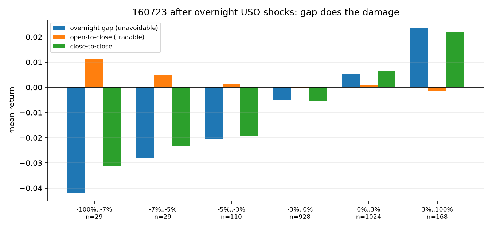

# 隔夜原油冲击与 160723 跳空风险

2026-11-02 美盘 USO 收跌 7.08%，11-03 中国开盘前已发生。本文回答两点：现有策略用没用美原油价格；历史上这类隔夜冲击能否被规则化地规避。

## 现有因子中的美原油

| 用途 | 数据 | 是否直接择时 |
|---|---|---|
| 3-2-1 裂解价差 | EIA WTI/汽油/取暖油现货 | 是，但 EIA 有发布滞后，用 `crack_lag` 延后 |
| 溢价估算 | USO 水平比 × lag3 NAV | 否，只用于估净值 |
| 隔夜动量/波动/跳空 | 无 | **否** |

所以策略会因裂解、库欣或溢价变化而减仓，但没有“美盘暴跌就降风险”的独立触发器。

## 跳空不可交易

对中国交易日 `t`，决策发生在 `t-1` 收盘（15:00），美盘在夜里运行，`t` 开盘时冲击已经反映在价格里。能交易的只有 open→close，跳空只能被动承受。

2017-05 至 2026-11-02 共 2289 个交易日，按隔夜 USO 收益分桶：

| 隔夜 USO | n | 跳空 | 日内 | 收盘至收盘 | 未来 5 日 | 日内为负占比 |
|---|---:|---:|---:|---:|---:|---:|
| ≤−7% | 29 | −4.18% | **+1.13%** | −3.13% | −4.21% | 38% |
| −7%～−5% | 29 | −2.80% | +0.51% | −2.31% | +1.12% | 41% |
| −5%～−3% | 110 | −2.06% | +0.13% | −1.94% | −0.21% | 45% |
| −3%～0 | 928 | −0.51% | −0.02% | −0.54% | +0.30% | 50% |
| 0～3% | 1024 | +0.54% | +0.09% | +0.64% | +0.55% | 41% |
| >3% | 168 | +2.35% | −0.15% | +2.19% | +0.44% | 46% |

关键点：暴跌日的亏损基本都在跳空里；开盘后反而平均反弹，极端组 +1.13%。因此“看到暴跌后在开盘砍仓”在历史上是负贡献。

## 假设与验证

统一用开盘执行：隔夜仓位吃跳空，当日仓位吃 open→close，换手单边 3bp；这样跳空和日内才分得开。基准是正式 10/5 配置在该口径下的结果。

| 假设 | 规则 | 全期 年化/夏普/卡玛 | 最大回撤 | 结论 |
|---|---|---:|---:|---|
| 基准 | 正式 10/5，开盘执行 | 28.18/1.248/1.161 | −24.3% | — |
| H1 暴跌后当日减仓 | 隔夜 ≤−4% 则当日空仓 | 26.60/1.207/1.113 | −23.9% | 卡玛变差 |
| H1 | ≤−5% | 27.23/1.215/1.091 | −25.0% | 变差 |
| H1 | ≤−6% | 27.95/1.240/1.213 | −23.0% | 略好，样本少 |
| H2 暴跌后冷却 5 天 | ≤−7% 后空仓 5 日 | **33.83/1.501/1.466** | −23.0% | 事后择优，见下 |
| H3 趋势减半 | USO 20 日动量 <0 时半仓 | 26.09/1.318/1.093 | −23.9% | 夏普升、卡玛降 |
| H3 趋势空仓 | 同上，直接空仓 | 23.52/1.264/0.968 | −24.3% | 收益损失大 |
| H4 波动率减半 | USO 20 日波动处于历史 80% 分位以上时半仓 | 25.98/1.312/0.836 | −31.1% | 更差 |
| H5 高溢价开盘减仓 | 开盘溢价 >3% 则当日空仓 | 15.9/0.883/0.659 | −24.2% | 方向相反，撤回 |

H5 的方向值得单独记一笔：开盘溢价 >3% 时，日内平均 +0.38%（t=2.87），>5% 时 +0.38%（t=2.29）。溢价在这段样本里更像动量，不是日内均值回归，所以“高溢价就卖”是错的。

## H2 为什么不能采用

“≤−7% 后空仓 5 天”结果是全场最好，但增量几乎全部来自少数事件：

- 2022-03-10 单次贡献 +13.1 个百分点，那天是俄乌冲突冲高后的回落起点。
- 2021-11-29 +2.6pp、2022-03-29 +3.0pp、2022-07-06 +4.5pp。
- 2022 年一年贡献 +28.7pp，其他年份合计接近零。
- 2020 年 14 次极端冲击全部无效，因为溢价层早已把仓位降到 0；2026 年 5 次也大多无效。

阈值 −7%、窗口 5 天都是扫过 1/3/5/10/20 天后挑的；3 天卡玛 1.383、10 天 1.222，曲线不平滑。29 个事件、窗口互相重叠，t 值不能按独立样本解读。

随机安慰剂（随机选同样数量的 5 日窗口空仓 300 次）里，这个规则仍高于 95% 分位；说明它不是“随便少拿几天”能解释的，但也无法排除它只是 2022 年那一段行情的产物。结论：**保留为待检验假设，不进入正式配置**。

## 对今天的含义

- 11-02 隔夜 USO −7.08%，落在 ≤−7% 组；历史上该组平均跳空 −4.2%。
- 用 11-02 美盘收盘重算，11-03 开盘溢价约 +3.98%，正式规则仍给 100%。
- 溢价层在 76% 的 ≤−7% 日子里本来就已经空仓；这次它没有，因为溢价仍在 5% 以下。
- 若按 H2，今天开盘应空仓并保持 5 个交易日；但该规则未通过稳健性检验，属于主观风控，不是策略信号。

可选的现实做法只有三类：接受跳空并维持 100%；主观降仓（没有历史验证支持）；或在此载体之外用期货/期权对冲。LOF 本身没有做空或期权工具，规则层无法消除跳空。

## 限制

- USO 有展期和费用，不等同 WTI 连续合约；隔夜冲击用 USO 度量会有偏差。
- 事件窗口重叠，5 日远期收益的 t 值被高估。
- 只覆盖 2017 年以来 29 次极端事件，2020 与 2022 是不同状态。
- 开盘价来自 LOF 二级市场，未纳入集合竞价滑点和容量。
- 复算：`python overnight_risk.py`，输出 `output_overnight/`。
