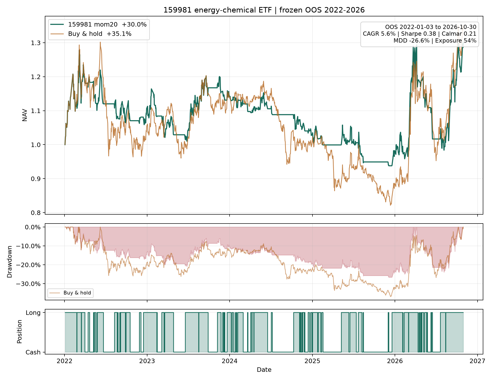

# 159981 能源化工 ETF 独立策略

## 结论

这是一个完全独立于 160723 的 159981 只做多策略。按预注册规则，训练期选择了 20 日动量，但 2022–2026 留出检验**没有通过超额收益验收**。

| 2022-01–2026-10 | 年化 | 夏普 | 卡玛 | 最大回撤 | 总收益 | 平均仓位 |
|---|---:|---:|---:|---:|---:|---:|
| **159981 mom20** | **5.60%** | **0.382** | **0.210** | **−26.61%** | **30.01%** | 53.7% |
| 买入持有 159981 | 6.45% | 0.386 | 0.175 | −36.90% | 35.15% | 100% |

20 日动量降低了约 10 个百分点回撤，但没有提高夏普，总收益和年化都低于买入持有。收益差的年化均值为 **−1.88%**，20 日块 bootstrap 95% 区间 **−13.85% 至 +11.47%**，没有正超额证据。

因此：

- 若目标是收益或夏普，当前最优可执行选择是**买入持有 159981**。
- 若目标是较低回撤，mom20 是现有候选中的风控型版本，但不应称为有效 alpha。
- 当前没有可认证的“最优主动 OOS 策略”。

## 规则

```
信号(t) = 1 if close(t) > close(t-20) else 0
执行 = 收盘生成信号，下一交易日开盘调仓
仓位 = 0 或 1，只做多、不加杠杆
成本 = 单边 3bp
```

选模只使用 2020-11-19–2021-12-31：12 个候选统一在 200 日预热后的共同起点比较，要求至少 6 次往返，按训练夏普选模。选中 mom20 后冻结，再跑一次 2022–2026。

训练夏普最高的其实是 SMA60（1.682），但它只有 1.5 次往返，不满足预注册的最低 6 次，不能入选。

| 训练 | 总收益 | 年化 | 夏普 | 卡玛 | 最大回撤 | 往返次数 |
|---|---:|---:|---:|---:|---:|---:|
| mom20 | 57.46% | 50.29% | 1.554 | 1.574 | −31.96% | 8 |

## 年度留出收益

| 年份 | mom20 | 买入持有 |
|---|---:|---:|
| 2022 | +10.64% | +5.44% |
| 2023 | +3.71% | +8.60% |
| 2024 | −10.33% | −11.81% |
| 2025 | −4.60% | −12.29% |
| 2026（至 10-30） | +32.44% | +52.60% |

2026 年策略过早退出或减仓，牺牲了大部分上涨，是总收益落后的主要原因。



## 运行

```sh
cd 能化
python research.py                 # 仅训练期候选表
python evaluate.py                 # 冻结训练/留出与图
python current_signal.py           # 最新信号
python -m unittest discover -s tests -v
```

## 文件

- `PREREGISTRATION.md`：选模规则和候选集合。
- `strategy.py`：数据、信号、下一开盘执行和指标。
- `research.py`：只用训练期的候选筛选。
- `evaluate.py`：冻结后的训练/留出、bootstrap 和图。
- `config.json`：冻结配置。
- `output/train_candidates.csv`：训练候选表。
- `output/metrics.json`：训练、留出、基准和年度结果。
- `output/positions.csv`：逐日信号、仓位和收益。
- `output/oos_candidates_diagnostic.csv`：冻结后全部候选的留出诊断，仅用于解释，不用于重新选模。
- `output/oos_nav.png`：2022–2026 留出图。
