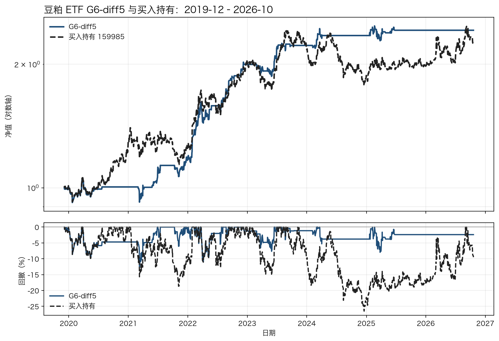
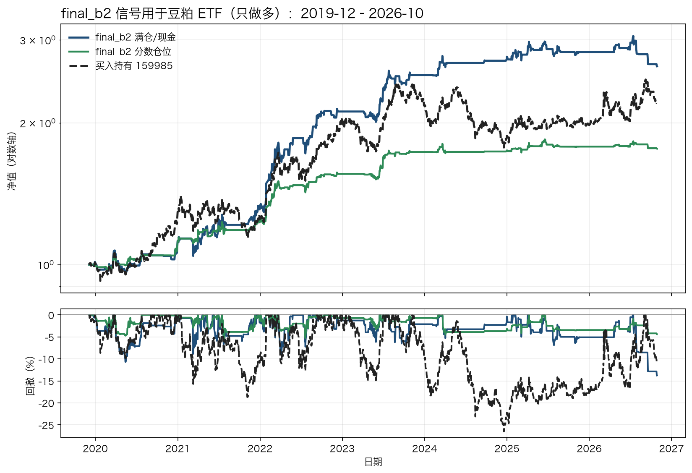
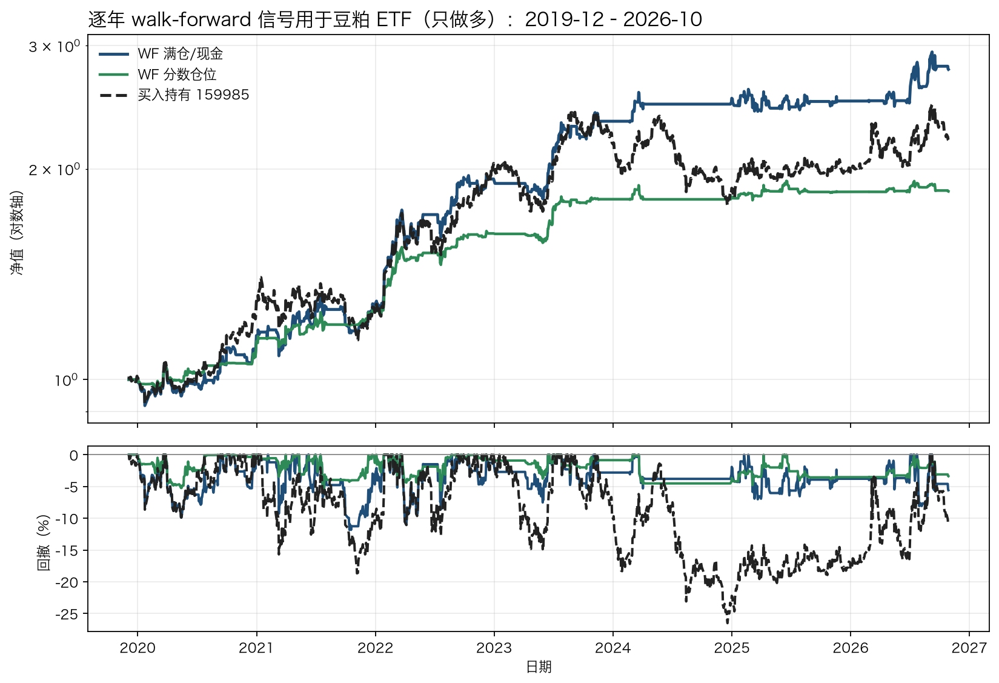

# 豆粕全因子择时策略（系列 26 复现）

本目录是国泰君安期货《因子与指数投资揭秘系列二十六：豆粕基本面与量价择时多因子模型研究》的独立复现与优化版本。当前状态：**历史研究组合，未完成原文完整复现，不可直接实盘**。

## 策略公式

```
最终仓位 = sign(0.8 × 基本面5因子 + 0.2 × 量价9因子)
```

- 单因子均为 0/1/-1（看空/看平/看多），等权合成。
- 1 倍杠杆，双边万三，收益按累加计算。
- t 日收盘出信号，t+1 收盘执行（夜盘/次日日盘的近似）。
- 主力连续 M0；对 2014-10-08 异常合约做清洁，日收益截断 ±6%。

## 基本面 5 因子

| 因子 | 方向 | 变换 | 参数 |
|---|---|---|---|
| 豆粕基差 | 正向 | 水平 z | 250 日 |
| 港口大豆库存 | 反向 | 水平分位 | 520 日 |
| 压榨利润代理 | 反向 | 水平 z | 250 日 |
| 原料大豆库存 | 反向 | 水平分位 | 520 日 |
| 豆菜价差 | 正向 | 20 日变化分位 | 窗口 60 日 |

## 量价 9 因子

TRIX 6/10/30、CCI 20/150 正向、MA 10/20 + 1% 死区、布林 20/2.5、KAMA 20 斜率 + 0.5% 死区、波动 40 放大、中值均线 3/15、佳庆 5/10、日内动量 10 日均线。

## 历史表现

| 区间 | 年化 | 夏普 | 卡玛 | 最大回撤 |
|---|---:|---:|---:|---:|
| 2016–2021 训练 | 7.0% | 0.36 | 0.27 | -25.5% |
| 2022–2024 伪样本外 | 21.6% | 1.00 | 0.74 | -29.4% |
| **2025–2026 真样本外** | **17.5%** | **1.08** | **0.91** | -19.2% |
| 2022–2026 合并 | 19.9% | 1.01 | 0.68 | -29.4% |

对照：纯优化基本面 5 因子 2025–2026 为 17.0%/1.05/0.89；纯优化量价 9 因子为 -5.3%/-0.35/-0.20。20% 量价的作用是分散，不是独立 alpha。

2025–2026 的 20 日块 bootstrap 夏普 90% 区间为 **[-0.05, 2.11]**，中位 1.04；432 个交易日只覆盖一个状态。

## G6-diff5 豆粕 ETF 策略（2019-12–2026-10）

独立脚本 `g6_diff5_etf.py`：6 因子等权、可用因子≥3、`score>0` 满仓，否则空仓；价格用 159985 实际收盘，收盘决策、下一开盘执行，单边 3bp。

因子：大豆库存同比、港口库存同比、基差 252 日 z、豆菜价差反向 252 日 z、仓单 5 日变化 252 日 z、华东豆粕库存 52 周 z。

| 项目 | G6-diff5 | 买入持有 159985 |
|---|---:|---:|
| 年化 | **13.71%** | 12.43% |
| 波动 | 12.3% | 19.5% |
| 夏普 | **1.151** | 0.724 |
| 最大回撤 | **−12.5%** | −26.5% |
| 卡玛 | **1.097** | 0.469 |
| 平均仓位 | 32.7% | 100% |
| 年换手 | 11.3 | 0 |



年度收益：2021 +18.0%、2022 +68.5%、2023 +11.2%、2024 +5.7%、2025 +3.0%、2026 0.0%。

**2025–2026 为什么弱：** 2026 年大豆库存同比、港口库存同比、价差反向同时看空（年均信号约 −0.95、−0.73、−0.97），只有基差看多（+0.38），6 因子多数为负，全年基本 0 仓位；而 159985 当年上涨 13.1%。2025 年同样是库存同比偏空、敞口只有约三成，只取得 +3.0%。这是供给端因子在需求/政策驱动上涨中的失效，不是执行或费用问题。

改善测试（研究记录，不在本脚本内）：20–30% 永久基础仓位可把 2025–26 从约 0.4% 提到 2.5–3.6%，但 2019–26 夏普从 1.15 降到 1.10–1.14；30% K2 + 30% G6 + 40% 全因子可把 2025–26 提到约 4.8%，2019–26 为 12.19%/1.126。**没有简单参数能既救 2025–26 又不伤历史；下一步应补养殖利润等需求端数据。**

运行：

```sh
python g6_diff5_etf.py --output output
```

输出：`output/g6_diff5_metrics.json`、`output/g6_diff5_positions.csv`、`output/g6_diff5_nav.png`。

## final_b2 信号用于豆粕 ETF（只做多）

`final_b2_etf.py` 复现最终融合信号：

```
final_b2 = 20% PV+VT15 + 20% PV+vol40 + 40% G6 + 10% K2 + 10% 基差
```

- PV+VT15：TRIX 6/10/30 + CCI 20/150 + 布林 20/2.5 + 中值均线 3/15，15% 波动目标。
- PV+vol40：上述四因子再加波动趋势 40/30。
- G6：大豆同比、港口同比、基差、豆菜价差反向、仓单 5 日变化、华东库存。
- K2：压榨利润 + 豆粕库存。

期货口径（M0，2016–2026，3bp）：全期 14.4%/1.367/0.875，2022–26 OOS 18.4%/1.727，2025–26 4.2%/0.512。

ETF 映射（159985，2019-12–2026-10，次日开盘，单边 3bp）：

| 版本 | 年化 | 夏普 | 卡玛 | 最大回撤 | 平均仓位 | 2025 | 2026 |
|---|---:|---:|---:|---:|---:|---:|---:|
| final_b2 满仓/现金 | **15.1%** | **1.164** | 1.097 | −13.8% | 40.0% | +2.2% | −6.6% |
| final_b2 分数仓位 | 8.6% | 1.164 | **1.504** | **−5.7%** | 18.2% | +1.9% | −1.0% |
| 买入持有 159985 | 12.1% | 0.709 | 0.457 | −26.5% | 100% | +5.4% | +11.2% |



满仓/现金版收益最高，但 2026 为 −6.6%；分数仓位版收益低、回撤只有 −5.7%，更接近“低波动绝对收益”的用法。两者 2022 年都贡献了大部分收益，2025–26 的上涨捕获仍弱于买入持有。

运行：

```sh
python final_b2_etf.py
```

输出：`output/final_b2_etf_metrics.json`、`output/final_b2_etf_positions.csv`、`output/final_b2_signal.csv`、`output/final_b2_etf_nav.png`。

## 逐年 walk-forward（期货 + ETF）

`wf_final.py` 每年 1 月只用此前 3 年，从 8 套固定模板中选一套，下一整年不再改；成本 3bp。

期货 M0 2019–2026：**16.55%/1.495/1.707**，最大回撤 −9.69%，八年全为正：2019 +18.3%、2020 +8.3%、2021 +14.4%、2022 +33.1%、2023 +23.5%、2024 +25.7%、2025 +6.8%、2026 +2.0%。

逐年选择：2019 PV_VOL；2020–2023 final_b2+10%多头；2024 PV50+G50；2025–2026 final_b2+10%多头。

ETF 只做多（159985，2019-12–2026-10）：

| 版本 | 年化 | 夏普 | 卡玛 | 最大回撤 | 平均仓位 | 2025 | 2026 |
|---|---:|---:|---:|---:|---:|---:|---:|
| WF 满仓/现金 | **15.95%** | **1.097** | 1.348 | −11.8% | 51.7% | −0.9% | +11.0% |
| WF 分数仓位 | 9.39% | 1.201 | **1.621** | **−5.8%** | 21.0% | +1.6% | +0.15% |
| 买入持有 159985 | 12.1% | 0.709 | 0.457 | −26.5% | 100% | +5.4% | +11.2% |



这不是干净的未看 OOS：8 套候选模板是看过 2016–2026 后设计的，walk-forward 只验证“每年怎么选模板”的规则；2025–2026 也已反复查看。真正的未看确认仍要从 2027 开始。

运行：

```sh
python wf_final.py
```

输出：`output/wf_final_metrics.json`、`output/wf_final_futures_positions.csv`、`output/wf_final_etf_positions.csv`、`output/wf_final_etf_nav.png`。

## 运行

```sh
cd /Users/hsh/Documents/Quant/商品择时/豆粕
python strategy.py --output output
python -m unittest discover -s tests -v
```

需要 pandas、numpy、matplotlib。`data/` 已包含复算所需的 M0/RM0/A0/Y0、基差、仓单、港口库存、原料库存、华东豆粕库存、豆菜价差和 159985 ETF 数据。

`strategy.py` 输出：

- `output/positions.csv`：逐日目标仓位。
- `output/metrics.json`：训练/伪OOS/真OOS/合并指标。
- `output/parameters.json`：冻结参数。

## 数据覆盖补充

- 已加入 `data/hog_sow_monthly.csv`（能繁母猪存栏，2009-01..2026-06），但单因子弱，未进入当前模型。
- 已加入 `data/M0_roll_adjusted.csv`（12 处换月缺口复权诊断），尚未替换 `strategy.py` 的 clipped M0。
- 2016–2017 全国原料库存、2016–2021 全国豆粕库存仍缺；详见 `data/DATA_COVERAGE.md`。

## 重要限制

1. 原文没有披露 0/1/-1 的阈值、库存标准化、平滑/滞回和部分量价窗口；本策略的映射是反推，不是原文公式。
2. 只用了 5/9 个基本面因子；生猪存栏只有年度数据，2016–2021 的原料/豆粕库存历史缺失。
3. 基差、仓单已补：基差 2016–2024、仓单 2005–2026。
4. M0 是 Sina 不复权主连，换月路径与商业复权合约不同。
5. 2025–2026 是真样本外，但只有 432 个交易日、一个市场状态；权重 0.8/0.2 是在伪OOS/留出上诊断选择的，不是预先冻结的最优权重。

## 文件

- `strategy.py`：策略与回测代码。
- `data/`：复算数据。
- `artifacts/`：优化网格、A/B、入选参数与验证记录。
- `研究说明.md`：完整复现报告（含 r2q 协议、量价优化失败、基本面优化细节）。
- `tests/`：冒烟测试。
